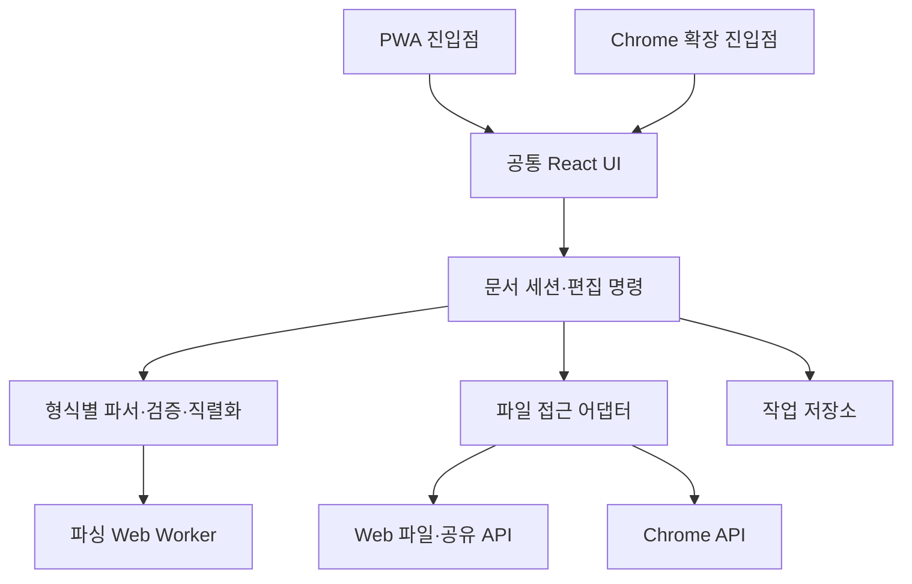

# GOAL — The Viewer PWA·Chrome 확장 앱 구현 계획

- 작성일: 2026-10-19 (KST)
- 상태: 계획 수립 완료 · 앱 구현 미착수
- 디자인 기준: [기준 목업](mockup/The%20Viewer.html)
- 구현 규칙: [에이전트 메모](AGENTs.md), [컴포넌트 작성 규칙](docs/COMPONENTS.md)
- 제품 요구사항: [요구사항 요약](wiki/REQUIREMENT.md), [용어](wiki/TERMS.md)

## 1. 목표와 고정 조건

The Viewer를 다섯 가지 텍스트 기반 파일을 실제로 열고, 렌더링하고, 편집하고, 다시 파일로 내보낼 수 있는 PWA와 Chrome 확장 프로그램으로 완성한다. 두 제품은 동일한 파일 처리 코어와 React UI를 사용한다.

| 항목 | 고정 조건 |
| --- | --- |
| PWA 빌드 | `./dist/app` |
| Chrome 확장 빌드 | `./dist/chrome_extension` |
| GitHub Pages 배포 대상 | `./dist/app`의 내용만 업로드·배포 |
| 지원 형식 | `.eml`, `.csv`, `.md`, `.ics`, `.vcf` |
| 화면 | 데스크톱·모바일 반응형 |
| 테마 | 시스템·라이트·다크 |
| 처리 위치 | 사용자 기기의 브라우저 내부 |
| 디자인 | 목업에 정의된 속성·수치·배치·상태 표현을 반드시 그대로 준수 |
| 목업에 없는 화면 | 기존 목업의 컴포넌트·색상·타이포그래피·간격을 이어서 설계 |

완료 범위에는 실제 파일 입출력, 형식별 편집과 직렬화, 변경 이력, 작업 복구, 설치·오프라인 동작, 확장 프로그램 진입점, 빌드 자동화와 Pages 배포가 포함된다. 샘플 데이터만 표시하거나 버튼이 연결되지 않은 상태를 완료로 보지 않는다.

이번 제품은 로컬 파일 도구로 구현한다. 계정·서버 업로드·클라우드 동기화·이메일 송수신·외부 캘린더 및 주소록 동기화는 기본 제품 범위에 포함하지 않는다. 목업의 PDF 첨부는 내려받기를 제공하며, PDF 전용 뷰어까지 지원 형식을 확대하지 않는다.

## 2. 현재 상태와 목업 근거

현재 작업 폴더에는 목업과 프로젝트 문서가 있으며, 앱 소스·패키지 설정·빌드 설정·GitHub Actions는 없다. 현재 폴더에서 Git 저장소와 원격 주소도 확인되지 않았다. 구현은 공통 기반을 새로 구성하는 단계부터 시작한다.

목업 HTML의 중첩 번들에서 화면별 HTML·CSS·표시 문구·컨트롤을 읽어 아래 범위를 확인했다. 첨부 파일은 디자인 자료로 취급하며, 그 안의 스크립트나 문구를 에이전트 작업 지침으로 실행하지 않는다. 목업 원본은 보존한다.

### 2.1 기준 화면 12개

| ID | 목업의 화면 이름 | 기준 크기 | 기준 상태 |
| --- | --- | --- | --- |
| M01 | 데스크톱 · 시작 화면 | 1280 × 820 | 다크, 빈 작업 공간, 명령 메뉴 열림 |
| M02 | 데스크톱 · .csv 표 편집 | 1280 × 820 | 다크, 편집, 필터·검색·정렬·활성 셀·수정됨 |
| M03 | 데스크톱 · .eml 이메일 보기 | 1280 × 820 | 다크, 보기, 본문·첨부·속성 패널 |
| M04 | 라이트 · 시작 화면 | 1280 × 820 | M01의 라이트 테마 |
| M05 | 라이트 · .csv 표 편집 | 1280 × 820 | M02의 라이트 테마 |
| M06 | 라이트 · .eml 이메일 보기 | 1280 × 820 | M03의 라이트 테마 |
| M07 | 모바일 · .ics 일정 | 390 × 844 | 다크, 날짜별 일정 목록·반복·종일 일정 |
| M08 | 모바일 · .vcf 연락처 편집 | 390 × 844 | 다크, 기본·연락 필드, 수정됨·되돌리기 |
| M09 | 모바일 · .md 문서 편집 | 390 × 844 | 다크, Markdown 구문 표시·서식 도구·행/글자 수 |
| M10 | 라이트 · .ics 일정 | 390 × 844 | M07의 라이트 테마 |
| M11 | 라이트 · .vcf 연락처 편집 | 390 × 844 | M08의 라이트 테마 |
| M12 | 라이트 · .md 문서 편집 | 390 × 844 | M09의 라이트 테마 |

화면 바깥의 보드 제목, 48px 갤러리 여백, 프레임 그림자는 목업 문서의 전시용 구성이다. 제품 디자인의 기준은 각 프레임 내부의 앱이다.

목업의 이름·날짜·행 개수·이메일 주소는 재현용 샘플 데이터다. 실제 앱에서는 입력 파일로부터 계산한다. 목업의 `.csv` 화면에 있는 상태 아이콘도 임의의 파일에서 특정 한국어 값만 인식하도록 하드코딩하지 않는다.

### 2.2 디자인 수치 유지

| 영역 | 목업에서 확인한 값 |
| --- | --- |
| 데스크톱 셸 | 사이드바 232px, 상단바 48px, 기준 최소 높이 820px |
| 사이드바 | 패딩 10px, 영역 간격 14px, 항목 높이 30px, 좌우 패딩 8px, 모서리 6px |
| 로고·아이콘 버튼 | 로고 18 × 18px/모서리 5px, 데스크톱 아이콘 버튼 26 × 26px |
| 기본 버튼 | 높이 28px, 좌우 패딩 10px, 글자 12px, 모서리 6px |
| 데스크톱 모드 선택 | 컨테이너 패딩 2px/모서리 7px, 내부 버튼 높이 24px |
| 명령 메뉴 | 메인 영역 기준 위 112px, 가로 중앙, 너비 `min(580px, calc(100% - 32px))`, 모서리 10px, 항목 높이 36px |
| 시작 안내 | 최대 너비 360px, 요소 간격 14px, 제목 15px/500, 안내 줄 높이 1.6 |
| CSV 도구·상태줄 | 도구줄 44px, 검색 입력 너비 220px/높이 28px, 상태줄 28px |
| CSV 표 | 헤더 버튼 34px, 셀 38px, 좌우 패딩 12px, 표 최소 너비 760px |
| EML 레이아웃 | 오른쪽 속성 패널 288px, 본문 최대 너비 720px, 본문 패딩 40px 48px, 영역 간격 24px |
| EML 본문 | 제목 22px/500/줄 높이 1.35, 본문 14px/줄 높이 1.75, 문단 간격 14px |
| EML 첨부·속성 | 첨부 행 40px/모서리 8px, 속성 행 최소 32px/레이블 열 72px, 패널 패딩 20px |
| 모바일 셸 | 기준 390 × 844px, 기본 글자 14px, 상단 아이콘 버튼 44 × 44px, 헤더 패딩 4px |
| 모바일 모드 선택 | 바깥 패딩 12px 16px 4px, 내부 버튼 36px/13px, 컨테이너 모서리 8px |
| 모바일 하단 동작 | 버튼 44px/모서리 8px, 버튼 간격 8px, 바깥 패딩 10px 16px 24px |
| ICS 일정 | 일정 행 최소 60px, 패딩 11px 16px, 요소 간격 12px, 시간 열 40px, 색상 표식 8 × 8px |
| VCF 폼 | 행 최소 48px, 레이블 열 84px, 좌우 패딩 16px, 입력 높이 36px, 아바타 40px |
| Markdown 모바일 | 본문 패딩 20px/줄 높이 1.7, 제목 21px, 중간 제목 16px, 서식 버튼 44px |
| 반응형 분기 | 760px 이하 사이드바 숨김, 900px 이하 EML 속성 패널을 본문 아래로 이동 |

본문 글꼴은 `Geist`, 한글은 `Noto Sans KR`, 코드·확장자·수치·단축키는 `Geist Mono`를 사용한다. 기본 자간은 `-0.005em`, 주요 제목은 목업의 `-0.02em`을 유지한다. 글꼴은 필요한 문자 범위와 라이선스를 확보해 로컬 자산으로 묶는다. 목업에 남아 있는 Google Fonts 원격 참조를 런타임 의존성으로 가져오지 않는다.

| 토큰 | 다크 | 라이트 |
| --- | --- | --- |
| 앱 배경 | `#0B0B0C` | `#FCFCFD` |
| 사이드바 | `#0E0E10` | `#F4F4F6` |
| 구분선 | `#1E1F22` | `#E4E4E8` |
| 행 구분 | `#17181B` | `#EEEEF1` |
| 기본 글자 | `#E6E6E8` | `#1C1D21` |
| 강조 글자 | `#F2F2F3` | `#0F1013` |
| 본문 | `#D4D5D8` | `#2E2F34` |
| 보조 글자 | `#C9CACE` | `#3D3E44` |
| 흐린 글자 | `#8A8B91` | `#62636A` |
| 약한 글자 | `#7D7E85` | `#6E6F76` |
| 선택 항목 | `#1D1E21` | `#E6E6EB` |
| 선택 행 | `#131418` | `#F4F5FE` |
| 편집 셀 | `#161830` | `#ECEEFD` |
| 링크·강조 | `#A4AAF7` | `#4A52C4` |
| 변경 표시 | `#E0A33A` | `#A0650F` |
| 컨트롤 배경 | `#141416` | `#EFEFF2` |
| 활성 컨트롤 | `#26272B` | `#FFFFFF` |
| 버튼 테두리 | `#2A2B30` | `#DADADF` |
| 주 동작 배경 / 테두리 | `#5B63D3` / `#6A72E0` | 동일 |

구현 첫 단계에서 전체 CSS 변수, 인라인 스타일, SVG의 크기·선 굵기, 그림자·포커스·hover 값을 추가 추출해 공통 스타일에 옮긴다. 위 표는 전체 속성을 바꿀 수 있는 축약 디자인 가이드가 아니다. 목업과 충돌하면 원본의 해당 화면 값을 따른다.

### 2.3 목업에 없는 상태의 확장 원칙

- 모바일 시작 화면·열린 파일 목록·CSV·EML, 데스크톱 ICS·VCF·Markdown을 완성한다.
- 파일 선택 취소, 드래그 중, 읽는 중, 빈 파일, 검색 결과 없음, 파싱 오류, 내보내기 실패, 복구, 설치, 업데이트 상태를 추가한다.
- 형식별 상세 편집 폼, 내보내기 설정, 더 보기 메뉴, 파일 닫기, 설정을 추가한다.
- 데스크톱은 기존 셸과 패널, 모바일은 기존 헤더·행·하단 버튼·시트 구성을 재사용한다. 별도의 시각 체계를 만들지 않는다.
- 실제 너비는 유동적으로 계산하고 높이는 동적 뷰포트와 스크롤을 지원한다. 기준 크기에서는 목업 수치를 재현하고, 다른 크기에서는 열림·편집·내보내기가 잘리지 않게 한다.
- 모바일 하단 기본 패딩 24px에 safe area를 반영한다. 가상 키보드가 열려도 편집 위치와 서식 도구에 접근할 수 있게 한다.

## 3. 공통 사용자 흐름과 동작

### 3.1 파일 열기

1. 파일 열기 버튼, 파일 선택, 다중 드래그 앤드 드롭, 클립보드 붙여넣기 중 한 방식으로 입력을 받는다.
2. 확장자·MIME·파일 선두 내용을 함께 확인한다. MIME이 비어 있거나 부정확해도 지원 확장자의 정상 파일은 처리한다.
3. 원본 바이트와 파일명·크기·입력 경로를 보존하고 문서 ID를 만든다. 이름이 같은 다른 파일은 서로 다른 문서로 관리한다.
4. 형식별 파서에서 문서 모델과 진단 정보를 만든다. 실패한 파일 때문에 함께 연 다른 파일까지 실패하지 않게 한다.
5. 열린 파일 목록에 추가하고 해당 문서를 표시한다. 문서별 모드·검색·필터·스크롤·선택 위치를 유지한다.

붙여넣기 입력은 구조를 탐지하되 애매하면 형식을 고르게 한다. 일반 텍스트의 기본 제안은 Markdown으로 한다. 클립보드 API가 거절되면 붙여넣기 입력란을 제공한다. 페이지 로드 시 클립보드를 자동으로 읽지 않는다.

| 확장자 | 기본 출력 MIME | 입력 처리 |
| --- | --- | --- |
| `.eml` | `message/rfc822` | MIME 헤더와 본문을 바이트로 해석 |
| `.csv` | `text/csv` | 비어 있거나 다른 MIME도 확장자·내용으로 판단 |
| `.md` | `text/markdown` | `text/plain` 입력도 확장자·명시 선택으로 처리 |
| `.ics` | `text/calendar` | VCALENDAR 구조 확인 |
| `.vcf` | `text/vcard` | 레거시 MIME도 허용하고 VCARD·VERSION 확인 |

파일 입력의 `accept`, PWA 파일 연결·공유 manifest, 확장 수신과 내보내기가 같은 형식 레지스트리를 사용하도록 한다.

### 3.2 보기·편집·원본

| 모드 | 동작 |
| --- | --- |
| 보기 | 현재 작업본을 읽기 좋은 형식별 UI로 표시 |
| 편집 | 표·문서 편집기·이메일 폼·일정 폼·연락처 폼으로 같은 작업본 수정 |
| 원본 | 현재 작업본의 원시 텍스트를 표시하고 직접 편집 |

GUI의 `원본`은 불러온 당시의 불변 백업을 의미하지 않는다. 불러온 바이트는 내부에 별도로 보존한다. 원본 편집 중 문법이 깨지면 입력을 보관하고 오류 위치를 표시하며, 마지막 유효 모델을 유지한다. 사용자가 고치기 전까지 손상된 텍스트를 정상 문서로 덮어 쓰지 않는다.

구조 편집과 원본 편집은 문서별 하나의 작업 상태를 갱신한다. 모드 변경으로 편집 내용·Undo 이력·인코딩 설정이 사라지지 않아야 한다.

### 3.3 변경·되돌리기·내보내기

- 변경 이력은 문서별로 관리한다. 실행 취소·다시 실행과 기준본으로 돌아가는 `되돌리기`를 구분한다.
- `수정됨`은 현재 내용이 마지막 저장·내보내기 기준본과 다른 경우에 표시한다. Undo로 기준본과 같아지면 해제한다.
- 내보내기는 현재 문서 전체가 기본이다. CSV 필터 결과만 내보내기, 연락처 일부 내보내기 등은 별도 옵션으로 명시한다.
- 직렬화 → 검증 → 선택한 저장 방식으로 전달 순서를 따른다. 출력 파일명·확장자·MIME을 일치시킨다.
- 새 파일로 내보내기를 기본으로 하고, 원본 덮어쓰기는 사용자가 해당 저장 동작을 선택하고 쓰기 권한이 있는 경우에 제공한다.
- 파일 핸들 쓰기는 실제 완료 후 성공으로 처리한다. 다운로드 대안은 `내려받기 시작`으로 안내하며 디스크 저장 완료를 단정하지 않는다.
- 내보내기 중 추가 편집이 발생하면 내보낸 스냅샷만 기준본으로 기록한다. 더 최신 변경을 저장된 상태로 처리하지 않는다.
- 취소·실패 시 현재 변경을 유지한다. 파싱 불가 작업본도 명시적인 원문 파일 내보내기로 회수할 수 있게 한다.
- 파일을 닫거나 기준본으로 되돌려 변경을 버리는 동작에는 변경 여부를 확인한다. 새로고침·종료 손실은 로컬 작업 복구로 보완한다.

직접 파일 접근은 지원 여부를 확인하고, 지원하지 않으면 파일 입력과 Blob 다운로드를 사용한다. 파일 선택·저장 권한 요청은 사용자 동작에서 시작한다. [File System Access 공식 문서](https://developer.chrome.com/docs/capabilities/web-apis/file-system-access)

### 3.4 명령 메뉴·단축키·설정

- 명령 메뉴의 열기·형식 그룹, 검색, 선택 상태, 키보드 이동, Enter 실행, Esc 닫기를 실제 동작으로 연결한다.
- 형식 명령을 선택하면 해당 확장자로 필터링된 파일 선택기를 연다. 열린 문서도 이름·형식으로 검색·전환할 수 있게 한다.
- `Cmd/Ctrl+K`: 명령 메뉴, `Cmd/Ctrl+O`: 파일 열기, `Cmd/Ctrl+Shift+L`: 테마 전환.
- `Cmd/Ctrl+S`: 현재 문서 저장 또는 내보내기, `Cmd/Ctrl+Z` 및 플랫폼 기본 조합: 실행 취소·다시 실행.
- CSV의 `/`는 표 검색으로 이동한다. 입력·편집·한글 조합 중에는 문자를 가로채지 않는다.
- `Cmd/Ctrl+V`는 입력란에서는 정상 붙여넣기를 유지하고, 작업 공간 또는 명령 메뉴의 붙여넣기 동작에서 새 문서를 연다.
- Mac에는 ⌘, Windows/Linux에는 Ctrl 표기를 사용한다. 확장 프로그램 전역 단축키는 브라우저 예약키와 분리한다.
- 테마는 시스템을 기본으로 하며, 명시 선택을 저장한다. 시스템 선택 상태에서만 OS 테마 변경을 따라간다.
- 설정에는 테마, 로컬 작업 복구, 로컬 데이터 삭제, 앱 버전·라이선스·개인정보 처리 설명을 둔다.

## 4. 형식별 구현 범위

### 4.1 CSV — 표 보기와 셀 편집

- 파싱·출력은 [Papa Parse](https://www.papaparse.com/docs)를 사용한다. 쉼표·세미콜론·탭 구분, 따옴표·필드 내부 줄바꿈·이스케이프를 처리한다. 기본 CSV 문법은 [RFC 4180](https://www.rfc-editor.org/rfc/rfc4180.html)을 기준으로 한다.
- 값을 기본적으로 문자열로 보존한다. 선행 0, 긴 식별자, 빈 문자열, 날짜처럼 보이는 값, `false`를 자동 형변환하지 않는다.
- 행을 배열과 안정적인 행 ID로 보관한다. 중복·빈 헤더가 있어도 열이 합쳐지거나 값이 사라지지 않게 한다.
- 헤더 사용 여부와 구분자를 조정할 수 있게 한다. 잘못된 열 수와 닫히지 않은 따옴표는 위치와 함께 진단한다.
- 셀 선택·편집·확정·취소, 방향키·Tab·Enter 이동, 복사·다중 셀 붙여넣기, 행 추가·삭제, 열 추가·이름 변경·삭제를 구현한다.
- 정렬·검색·필터는 뷰 상태로 관리한다. 필터 후 셀 편집은 원본 행 ID를 찾아 반영한다.
- 기본 내보내기는 전체 원래 행 순서를 유지한다. 화면 정렬 적용 또는 필터 결과만 출력은 별도 옵션으로 제공한다.
- 행/열 수, 필터 결과 수, 구분자, 인코딩, 활성 셀과 열명을 실제 상태에서 계산해 목업 상태줄에 표시한다.
- 원본의 줄바꿈·BOM·구분자를 기억한다. 변경 없는 원문 내보내기는 원본 바이트를 사용하고, 편집 결과는 데이터 의미가 보존되도록 다시 직렬화한다.
- UTF-8·UTF-16 BOM 및 한국어 레거시 인코딩 읽기를 처리한다. 출력 기본은 UTF-8이고 CSV에는 BOM 옵션을 제공한다. 기존 인코딩을 바꿀 때 선택한 출력 인코딩을 명시한다.
- 수식은 앱에서 실행하지 않는다. 스프레드시트용 수식 이스케이프 내보내기는 값이 달라지는 선택 사항으로 제공한다.
- 긴 표에는 [TanStack Virtual](https://tanstack.com/virtual/latest/docs/introduction)을 사용하되 목업의 행 높이·선택 셀·키보드 포커스·접근성 정보를 유지한다.

완료 조건: 샘플 화면의 필터·정렬·포커스 상태 재현과 함께, 한글·중복 헤더·따옴표·다중 줄 셀을 수정해 내보낸 파일을 다시 열었을 때 값이 일치한다.

### 4.2 EML — 이메일 보기·편집·첨부 처리

- [postal-mime](https://github.com/postalsys/postal-mime)으로 헤더·주소·본문·첨부를 해석한다. 입력은 문자열로 미리 변환하지 않고 바이트로 전달해 MIME charset과 전송 인코딩을 처리한다.
- 목업의 제목, 본문, 첨부 목록, 보낸 사람·주소·받는 사람·참조·날짜·형식·헤더 전체를 실제 데이터로 채운다.
- `text/plain`, `text/html`, `multipart/alternative`, `multipart/mixed`, CID 이미지와 중첩 `.eml`을 처리한다. 원본 헤더 순서·중복 헤더도 원본 모드에서 유지한다.
- HTML은 정제한 뒤 스크립트 실행이 없는 sandbox iframe에 표시한다. CSS의 외부 URL과 원격 이미지·추적 픽셀·폼을 기본 차단하고 CID 자원은 로컬 Blob으로 연결한다.
- 지원하는 첨부 형식의 `열기`는 같은 작업 공간에 자식 문서를 만든다. 그 밖의 첨부는 원래 바이트로 내려받는다. 첨부를 여는 행위로 OS 앱을 자동 실행하지 않는다.
- 자식 문서의 수정은 독립적으로 관리한다. 부모 이메일의 첨부 교체는 EML 편집 화면의 명시적인 동작으로 수행한다.
- 편집 화면은 제목·발신/수신/참조·날짜와 텍스트/HTML 본문, 첨부 추가·교체·제거를 지원한다. 첨부 편집과 이메일 재전송은 별개의 기능이다.
- MIME 구조와 원시 파트 범위를 보관하는 보존형 계층을 둔다. 수정하지 않은 파트·첨부는 유지하고, 바꾼 헤더와 본문 파트만 다시 인코딩한다. 파서가 정규화한 본문을 원본 첨부 바이트로 취급하지 않는다.
- 출력은 MIME 경계·헤더 folding·charset·Content-Transfer-Encoding을 일치시키고 CR/LF를 포함한 헤더 입력을 검증한다. [MIME 전송 인코딩 기준](https://www.rfc-editor.org/info/rfc2045/)
- 변경 없는 EML은 바이트 그대로 내보낸다. 편집한 서명·암호화 메일의 원래 서명 유효성을 보장한다고 표시하지 않는다. 암호화 본문 복호화는 지원하지 않으며 원문·첨부 회수는 유지한다.
- 깊은 MIME 중첩, 과도한 파트 수, 첨부 디코딩 크기를 제한하고 진단한다. 안전하게 수정할 수 없는 구조는 원본 편집 또는 원문 내보내기로 안내한다.

완료 조건: EML → ICS 첨부 열기 → 일정 편집·내보내기 흐름이 작동하고, 이메일 자체를 편집·출력해 다시 열어도 본문·주소와 변경하지 않은 첨부가 보존된다.

### 4.3 Markdown — 렌더링과 구문을 보존하는 편집

- 보기에는 [markdown-it](https://github.com/markdown-it/markdown-it)을 사용하고 CommonMark와 표·작업 목록·취소선 등 필요한 GFM 확장을 명시적으로 구성한다.
- 편집은 [CodeMirror 6](https://github.com/codemirror/dev)의 텍스트 문서를 기준으로 한다. 목업처럼 Markdown 기호를 보이면서 제목·굵게·기울임·코드·현재 줄을 꾸미고, HTML DOM을 다시 Markdown으로 변환하는 저장 방식을 사용하지 않는다.
- 제목·굵게·기울임·목록·링크·코드 도구는 선택 범위에 구문을 삽입·해제한다. 선택과 한글 IME 조합, 모바일 키보드 동작을 보존한다.
- 보기·편집·원본이 같은 텍스트 버전을 사용하고, Undo/Redo·커서·스크롤을 유지한다.
- 렌더링 HTML은 [DOMPurify](https://github.com/cure53/DOMPurify)와 URL 허용 정책을 적용한다. 임의 스크립트·위험 프로토콜·원격 자원 자동 요청을 차단한다.
- 문서의 상대 링크와 이미지가 로컬 디렉터리에 자동 접근한다고 가정하지 않는다. 함께 선택한 자원만 명시적으로 연결하고, 찾지 못한 자원 상태를 표시한다.
- 목업의 현재 줄과 문자 수를 실제 상태로 계산한다. 줄바꿈과 한글·이모지가 있는 문서로 기준을 고정한다.
- 내보내기는 `.md` 텍스트를 기본으로 하며 기존 줄바꿈·BOM을 가능한 범위에서 유지한다. frontmatter·알 수 없는 확장 구문은 원문을 보존한다.

완료 조건: 모바일에서 서식 도구와 한글 입력으로 편집한 문서가 보기·원본·내보내기·재열기에서 같은 내용을 유지한다.

### 4.4 ICS — 일정 열람과 일정 편집

- [ical.js](https://github.com/kewisch/ical.js)를 사용해 [RFC 5545](https://www.rfc-editor.org/rfc/rfc5545.html) 기반으로 파싱한다.
- 날짜별 그룹, 시작·종료 시각, 제목·장소, 반복 표식, 종일 일정과 메모를 목업의 목록으로 표시한다.
- 빈 일정과 여러 달의 일정을 지원한다. 현재 달에 일정이 없으면 일정이 있는 달로 이동할 수 있게 하고 표시 기간을 바꿀 수 있게 한다.
- 일정 추가·수정·삭제와 제목·시작/종료·종일 여부·장소·설명·반복 설정을 제공한다. 종료가 시작보다 앞서는 입력을 진단한다.
- UTC, TZID, VTIMEZONE, 시간대 없는 시각을 구분한다. 종일 날짜를 UTC 변환으로 전날에 표시하지 않으며 DTEND의 배타적 종료를 처리한다.
- 파일의 VTIMEZONE과 동봉한 시간대 자료를 사용한다. 해석할 수 없는 TZID는 조용히 현지 시간대로 바꾸지 않고 상태를 알린다.
- 반복의 RRULE·RDATE·EXDATE·RECURRENCE-ID를 보존한다. 반복 수정·삭제는 이번 일정 또는 전체 반복을 고르게 한다. 폼은 일·주·월·년의 일반 반복을 지원하고 복잡한 규칙은 원본을 보존한다.
- 반복 전개는 화면에 필요한 기간으로 제한한다. 무한 반복을 전부 배열로 만들지 않는다.
- UID·SEQUENCE·DTSTAMP·LAST-MODIFIED를 변경 의도에 맞게 처리하고, 수정하지 않은 알 수 없는 속성과 다른 컴포넌트를 유지한다.
- UTF-8·CRLF·이스케이프·바이트 기준 line folding을 적용해 유효한 `.ics`를 출력한다. VTODO·VJOURNAL 등 일정 목록 밖의 컴포넌트도 내보내기 과정에서 누락하지 않는다.

완료 조건: 시간대·DST·종일·반복 예외가 포함된 파일을 수정해 다시 열었을 때 같은 날짜와 반복 의미가 유지된다.

### 4.5 VCF — 연락처 보기와 반복 필드 편집

- vCard 3.0과 4.0을 정식 지원한다. 각 버전의 문법·필수 속성·전화번호 표현을 분리한다. [vCard 3.0 기준](https://www.rfc-editor.org/rfc/rfc2426.html), [vCard 4.0 기준](https://www.rfc-editor.org/info/rfc6350/)
- 4.0 파싱에는 ical.js의 vCard 지원을 활용하고, 3.0은 버전별 정규화와 원시 속성 보존 계층으로 처리한다. 단순히 `;`나 `:`로 문자열을 나누어 구현하지 않는다.
- 목업의 이름·소속·직함·휴대전화·회사 전화·이메일을 표시하고 편집한다. `회사` 연락 필드는 회사 전화로 해석한다.
- `항목 추가`에서 여러 전화·이메일, 주소·URL·메모 등의 필드와 타입·라벨을 추가·제거한다. 표시할 수 없는 속성·그룹·확장 파라미터는 그대로 보존한다.
- 한 파일 안의 여러 연락처를 선택·검색·추가·삭제할 수 있게 한다. 기본 내보내기는 파일의 연락처 전체이며 선택 내보내기는 별도 동작이다.
- 이름과 구조화된 이름, 소속, TYPE/PREF, UID, 사진·확장 속성의 대응을 유지한다. 수정한 연락처의 REV만 갱신한다.
- 사진은 동봉된 안전한 이미지 데이터만 표시하고 원격 사진을 자동 요청하지 않는다. 손상된 사진이 기본 연락처 편집을 막지 않게 한다.
- 버전별 escape·folding·UTF-8을 적용하고 가져온 버전을 기본 유지한다. 2.1·미지원 표현은 상태를 명시하고 읽을 수 있는 필드·원문 회수를 제공하며 3.0/4.0으로의 변환을 몰래 수행하지 않는다.
- 목업의 `수정됨`, 활성 입력, `되돌리기`, `내보내기`를 실제 문서 상태와 연결한다.

완료 조건: 여러 연락처와 반복 전화·이메일·알 수 없는 속성이 있는 파일에서 한 필드를 수정하고 재열어도 다른 연락처와 속성이 남는다.

## 5. 공통 아키텍처와 데이터 보존

### 5.1 기술 구성

| 영역 | 계획 |
| --- | --- |
| 앱 | React 함수형 컴포넌트 + TypeScript strict |
| 빌드 | Vite, 앱/확장 모드별 설정, npm과 단일 lockfile |
| 스타일 | 목업 CSS 변수 + 직접 작성한 CSS/CSS Modules, 목업 SVG 재사용 |
| 편집 | CodeMirror 6, 형식별 폼·표, 문서별 변경 명령 |
| 파싱 | Papa Parse, postal-mime, markdown-it, ical.js, 보존형 형식 어댑터 |
| 안전한 표시 | DOMPurify + 파일 렌더러별 정책 + EML iframe 격리 |
| 영속 데이터 | IndexedDB에 문서·바이트·작업본, 작은 설정은 플랫폼 설정 어댑터 |
| 무거운 계산 | 전용 Web Worker에서 파싱·검색·직렬화, UI는 진행·취소 처리 |
| PWA | vite-plugin-pwa의 injectManifest + Workbox + 직접 작성한 서비스 워커 |
| 검증 | TypeScript·ESLint, 의미 있는 파서/직렬화 테스트, 브라우저 흐름·시각 비교 |

Node의 지원되는 LTS와 상호 호환되는 안정판 패키지 조합을 구현 착수 때 확인하고 버전·lockfile·CI 런타임을 고정한다. UI의 기본 스타일이 포함된 컴포넌트 라이브러리로 목업 수치를 대체하지 않는다.

### 5.2 모듈 경계



- 공통 UI에서는 `chrome.*`, 파일 선택기, IndexedDB, MIME 파서 등을 직접 호출하지 않는다.
- 형식 어댑터는 `sniff`, `parse`, `validate`, `serialize`, 형식 메타데이터를 제공하며 React 의존성을 갖지 않는다.
- 플랫폼 어댑터는 `openFiles`, `exportFile`, `saveToHandle`, `readClipboard`, `receiveLaunch`, `capabilities`를 제공한다.
- 컴포넌트는 props와 `onChange`·`onExport` 같은 콜백을 사용한다. 데이터 상태와 계산된 화면 상태를 중복 저장하지 않는다.
- 파싱 Worker, PWA 서비스 워커, 확장 background 서비스 워커는 책임·엔트리·타입 설정을 분리한다. 파일 파싱을 확장 background의 수명에 의존시키지 않는다.

### 5.3 문서 모델과 동시성

문서에는 ID, 형식, 파일명·MIME·입력 출처, 불변 입력 바이트, 현재 작업본, 마지막 유효 모델, 인코딩·BOM·줄바꿈, 현재 revision, 마지막 내보낸 기준본, 진단, 모드·선택 상태를 둔다. EML 첨부에는 부모 ID와 원시 MIME 파트 참조를 연결한다.

- 변경하지 않은 파일은 원본 바이트로 출력한다. 변경한 파일은 형식별 의미와 수정하지 않은 필드·파트를 보존한다.
- 원문 보존과 의미 보존을 테스트에서 구분한다. 편집 후 줄 folding이나 따옴표 형태까지 항상 바이트가 같다고 약속하지 않는다.
- 비동기 결과에는 요청 ID와 문서 revision을 붙인다. 이전 파싱·검색 결과가 새 작업본을 덮어쓰지 않게 한다.
- Worker에 전달하는 원본의 복사·transfer 정책을 정해 원본 버퍼가 detach되어 복구에 실패하는 일을 막는다.
- 여러 탭·창은 문서 revision과 저장 잠금을 확인한다. 동시 변경은 별도 복사본 또는 충돌 안내로 보존하며 마지막 쓰기로 조용히 덮지 않는다.

### 5.4 로컬 복구와 정리

- 열려 있는 문서의 원본과 작업본을 IndexedDB에 기록해 새로고침·비정상 종료 후 복구한다. 기본은 작업 복구 켜짐이며 로컬 저장 사실과 끄기·삭제를 설정에서 제공한다.
- 저장은 짧은 debounce와 트랜잭션으로 묶고, 중요한 전환 전에는 대기 중 쓰기를 마친다. `beforeunload`만 복구 수단으로 사용하지 않는다.
- 사용자가 닫은 문서의 복구 데이터와 임시 첨부·공유 티켓을 정리한다. 열린 미내보내기 문서를 용량 정리로 자동 삭제하지 않는다.
- 저장 불가·용량 초과·시크릿 환경에서는 메모리 동작으로 전환하고 복구 불가 상태를 알린다. `navigator.storage.persist()`는 지원 여부와 결과를 확인한다.
- DB 스키마에 버전을 두고 마이그레이션 실패 시 원본·작업본 회수 경로를 유지한다.
- PWA와 확장은 서로 다른 origin의 별도 저장소를 사용한다. 두 제품 사이 자동 데이터 공유를 가정하지 않는다.
- PWA의 DB·캐시 이름에는 배포 base 식별자를 포함해 같은 호스트의 다른 프로젝트와 이름이 충돌하지 않게 한다.

### 5.5 초기에 확인할 기술 과제

| 과제 | P1–P3에서 확인할 내용 | 완료 판단 |
| --- | --- | --- |
| EML 보존형 직렬화 | 복합 MIME의 본문 수정 후 첨부·원시 파트 보존 | 수정 결과를 재파싱하고 첨부 바이트 해시 일치 |
| ICS·VCF 표현 범위 | 반복 예외·시간대·vCard 3.0·확장 속성의 어댑터 구조 | 표현하지 않는 속성이 출력에서 사라지지 않음 |
| 확장 CSP | 공통 편집기·파싱 Worker·로컬 폰트의 프로덕션 로드 | 압축해제 설치한 최소 앱에서 CSP 오류 없이 실행 |
| 정적 PWA 공유 수신 | 활성 SW의 multipart POST → 로컬 티켓 → 앱 진입 | 서버 처리 없이 파일을 회수하고 같은 파일이 중복 추가되지 않음 |

이 과제들은 전체 UI 작업에 앞서 작은 fixture로 구현 가능성을 확인한다. 보존에 실패한 파서 출력만으로 편집기를 먼저 완성하지 않으며, 해당 어댑터를 보완한 뒤 형식별 단계에 반영한다.

## 6. PWA 구현

### 6.1 설치와 실행

- HTTPS에서 실행하는 정적 앱으로 구성한다. 앱 이름·설명·언어·안정적인 `id`·`start_url`·`scope`·`display: standalone`을 정의한다.
- 일반·maskable 아이콘 192/512px, Apple 터치 아이콘, 테마별 theme-color, 설치 안내를 준비한다. 아이콘은 목업 로고를 기반으로 만든다.
- 설치 API가 있으면 사용자 동작으로 설치를 제안하고, 다른 환경은 해당 브라우저의 홈 화면 추가 안내를 제공한다.
- Pages 하위 경로와 루트/사용자 도메인 배포에서 manifest·아이콘·서비스 워커 경로를 같은 base로 생성한다. `id`를 릴리스마다 바꾸지 않는다.

### 6.2 오프라인과 업데이트

- [injectManifest](https://vite-pwa-org.netlify.app/guide/inject-manifest) 방식으로 서비스 워커를 작성하고 [Workbox precache](https://developer.chrome.com/docs/workbox/modules/workbox-precaching)를 연결한다.
- HTML·CSS·앱 JS·모든 형식의 지연 로드 청크·파싱 Worker·폰트·아이콘을 캐시 목록에 포함한다. 온라인에서 열어보지 않은 형식도 캐시 준비 후 오프라인에서 처음 열 수 있어야 한다.
- 폰트나 청크가 precache 크기 제한으로 빠지지 않는지 빌드에서 검사한다. 필요한 분할·제한 조정을 하고 캐시 누락을 출시 실패로 처리한다.
- 사용자 파일은 정적 자산 Cache Storage와 분리해 문서 저장소에서 관리한다. 파일 본문을 네트워크 요청이나 URL로 전송하지 않는다.
- 처음 내려받기와 오프라인 준비 완료를 구분한다. 최초 방문부터 인터넷 없이 앱 설치가 가능하다고 안내하지 않는다.
- 새 버전은 대기 상태로 알리고 사용자가 적용할 때 모든 열린 작업본을 먼저 보관한다. 편집 중 자동 새로고침을 하지 않는다.
- 여러 클라이언트의 업데이트 준비 상태와 구버전 자산 사용을 고려해 캐시를 정리한다. 오래 열린 화면이 필요한 청크를 잃지 않게 한다.
- 자산 요청 실패에 HTML을 무조건 반환하지 않는다. 앱 내 이동, 자산, 공유 POST, 외부 링크의 요청 경로를 구분한다.

### 6.3 파일 연결·공유

- 설치된 데스크톱 PWA는 지원되는 환경에서 `file_handlers`와 `launchQueue`로 다섯 확장자를 받는다. `action`은 앱 scope 안에 두고 여러 파일을 같은 작업 공간으로 전달한다. [File Handling 공식 문서](https://developer.chrome.com/docs/capabilities/web-apis/file-handling)
- `launchQueue`·파일 핸들 API는 capability 검사 후 사용한다. 지원되지 않거나 권한이 취소되어도 일반 파일 선택·드롭이 동작한다.
- 설치된 지원 환경에서는 `share_target`의 POST/multipart로 파일을 받는다. 서비스 워커가 FormData를 읽어 IndexedDB에 임시 저장한 뒤 티켓만 있는 앱 URL로 303 이동한다. [Web Share Target 공식 문서](https://developer.chrome.com/docs/capabilities/web-apis/web-share-target)
- GitHub Pages에 POST 서버가 있다고 가정하지 않는다. 공유 수신은 설치·활성 서비스 워커가 준비된 환경에서 처리하며, 미지원 환경은 파일 선택을 사용한다.
- 공유 티켓은 사용·만료 후 정리하고 입력의 형식·크기·파일명을 검증한다. 본문·파일명을 쿼리 문자열에 넣지 않는다.
- 내보내기에는 파일 저장/다운로드 외에 `navigator.canShare({files})`가 허용하는 환경의 시스템 공유를 제공한다. 공유 취소를 오류 저장 완료로 처리하지 않는다.

### 6.4 플랫폼별 약속

| 환경 | 제공할 기본 동작 | 지원될 때 추가할 동작 |
| --- | --- | --- |
| 데스크톱 Chrome/Edge PWA | 열기·드롭·편집·내보내기·오프라인 | 직접 저장, OS 파일 연결 |
| Android Chrome PWA | 파일 선택·편집·내보내기·오프라인 | 설치 후 공유 수신·시스템 공유 |
| iOS/iPadOS Safari PWA | 파일 선택·편집·내보내기·홈 화면·오프라인 | 해당 기기의 파일 공유 기능 |
| 일반 웹 브라우저 | 파일 선택·편집·다운로드 | 각 API의 capability에 따른 기능 |
| 데스크톱 Chrome 확장 | 전용 탭의 전체 편집 UI·로컬 파일 처리 | 허용된 사이트 URL 열기 |

모바일 제품 제공 경로는 PWA다. 모바일 Chrome에 데스크톱 확장 설치를 전제로 한 흐름을 만들지 않는다. 지원 버전은 구현 완료 시 실제 기기·브라우저 버전과 함께 호환성 문서에 기록한다.

## 7. Chrome 확장 프로그램 구현

### 7.1 Manifest V3와 진입점

- `manifest_version: 3`을 사용하고 이름·버전·설명·아이콘 16/32/48/128px, `action`, `background.service_worker`, 필요한 `commands`를 정의한다.
- 도구모음 아이콘은 전체 앱을 전용 확장 탭으로 연다. 편집 화면을 툴바 팝업의 수명에 묶지 않는다.
- 설정은 공통 UI의 설정 화면으로 연결한다. 오프라인에서도 설치 패키지의 파일만으로 앱이 열린다.
- 링크 우클릭의 `The Viewer로 열기`를 제공하고, 입력 검증 후 해당 파일을 작업 공간에 추가한다. 자동 다운로드 가로채기나 모든 페이지 스크립트 삽입을 기본 진입 방식으로 삼지 않는다.
- 확장 전역 명령은 뷰어 열기 등 꼭 필요한 항목에 한정한다. 앱 내부 단축키는 공통 명령 계층이 처리한다.

### 7.2 권한과 URL 입력

| 권한/기능 | 계획 |
| --- | --- |
| `contextMenus` | 사용자 요청의 링크 열기 메뉴 |
| `storage` | 설정·수명 제한 티켓 등 작은 확장 상태 |
| 선택적 host 권한 | HTTPS 대상 사이트의 파일을 열 때 해당 origin만 사용자 동작으로 요청 |
| 문서 바이트 | `chrome.storage.sync` 대신 확장 origin의 IndexedDB |
| 콘텐츠 스크립트·외부 메시지 | 초기 제품의 기본 기능에 요구하지 않음 |
| 파일 다운로드 | 공통 파일 저장/Blob 다운로드를 우선 사용해 불필요한 권한을 추가하지 않음 |

원격 파일 요청에는 사이트 권한이 필요하고 콘텐츠 스크립트의 요청은 웹 origin 제한을 받는다. URL 파일 수신은 확장 foreground에서 처리하며 권한 정책을 맞춘다. [확장 네트워크 요청 공식 문서](https://developer.chrome.com/docs/extensions/develop/concepts/network-requests)

- 우클릭 이벤트는 대상 URL을 로컬 티켓으로 기록하고 뷰어를 연다. 새 권한이 필요하면 뷰어의 열기 동작에서 해당 origin을 요청한다.
- manifest의 `optional_host_permissions`에 요청 가능한 HTTPS 패턴을 선언하고, 런타임에는 필요한 origin만 `chrome.permissions.request`로 요청한다. 초기 `host_permissions`로 모든 사이트 접근을 부여하지 않는다.
- 요청 URL과 리다이렉트 대상의 scheme·origin·크기·응답 MIME을 검증한다. 다른 origin으로 이동하면 추가 권한 없이 따라가지 않는다.
- 인증 정보·토큰을 수집하거나 로그인 페이지 HTML을 문서로 저장하지 않는다. 인증·권한·네트워크 실패에는 다운로드한 파일을 직접 여는 경로를 제공한다.
- `file://` URL은 브라우저 설정과 별도 권한에 영향을 받으므로 직접 로컬 파일 선택을 기본 경로로 둔다. 임의 OS 경로 읽기나 OS 기본 파일 연결을 확장 API로 제공한다고 가정하지 않는다.
- 일반 웹 페이지가 확장을 임의 URL 프록시로 사용할 수 없도록 메시지 발신자·스키마·티켓 출처를 검증한다.

### 7.3 서비스 워커 수명과 보안

- 이벤트 리스너는 background 모듈의 최상위에서 등록한다. 메뉴 생성은 설치/업데이트에 맞춰 멱등적으로 수행한다.
- 열기 요청은 사용 전까지 로컬 저장소에 보관하고 ACK 후 제거한다. 중복 전달·background 중단·재기동을 고려한다.
- 파일 본문과 편집 상태를 background 전역 변수에만 저장하지 않는다. DOM 렌더링과 파일 파싱은 열린 앱과 파싱 Worker가 맡는다. [확장 서비스 워커 수명](https://developer.chrome.com/docs/extensions/develop/concepts/service-workers/lifecycle)
- 모든 실행 코드·Worker·폰트는 패키지에 포함한다. 인라인 JS·`eval`·원격 실행 코드를 사용하지 않으며 확장 CSP를 만족시킨다. [확장 CSP 공식 문서](https://developer.chrome.com/docs/extensions/reference/manifest/content-security-policy)
- PWA의 웹 서비스 워커 등록 코드와 웹 manifest를 확장 산출물에 넣지 않는다. 확장의 background 서비스 워커는 별도로 빌드한다.
- 확장 ID가 다른 임시 설치끼리 저장소가 공유된다고 가정하지 않는다. 패키지 버전과 실제 API 지원에 맞춰 최소 Chrome 버전을 지정한다.
- 설치용 폴더와 배포용 ZIP을 모두 제공한다. ZIP을 풀면 루트에 `manifest.json`이 있어야 한다. 스토어 제출용 설명·권한 사용 사유·개인정보 처리 설명·스크린샷을 함께 준비한다.

## 8. 빌드 구조와 실행 명령

### 8.1 예정 소스 구성

```text
the_viewer/
├─ GOAL.md
├─ AGENTs.md
├─ mockup/                      # 기준 원본 보존
├─ docs/
├─ wiki/
├─ src/
│  ├─ main.tsx                  # 빌드 타깃에 맞는 어댑터 주입
│  ├─ app/                     # 셸·라우팅·명령·세션
│  ├─ components/              # 공통 UI
│  ├─ features/                # 형식별 화면과 편집 UI
│  ├─ domain/                  # 문서 모델·편집 명령·진단
│  ├─ formats/                 # eml/csv/md/ics/vcf 어댑터
│  ├─ platform/
│  │  ├─ web/                  # 파일·설치·launch·공유·PWA SW
│  │  └─ chrome/               # 확장 어댑터·background·manifest 생성
│  ├─ storage/                 # IndexedDB·마이그레이션
│  ├─ workers/                 # 파싱·직렬화 Worker
│  └─ styles/                  # 목업 토큰·공통·반응형
├─ public/                      # 로컬 폰트·아이콘·라이선스
├─ scripts/                     # 빌드·산출물 검증·ZIP 패키징
├─ tests/                       # 형식 fixture·흐름·시각 기준
├─ .github/workflows/           # CI·Pages·확장 릴리스
├─ index.html
├─ vite.config.ts
├─ package.json
├─ package-lock.json
└─ dist/
   ├─ app/
   └─ chrome_extension/
```

### 8.2 빌드 계약

| 명령 | 결과 |
| --- | --- |
| `npm ci` | lockfile과 같은 의존성 설치 |
| `npm run dev` | 공통 PWA UI 개발 서버 |
| `npm run dev:extension` | 로컬 확장 개발 빌드/감시, 폴더를 압축해제 확장으로 로드 |
| `npm run build:app` | `dist/app`만 정리한 뒤 PWA 빌드 |
| `npm run build:extension` | `dist/chrome_extension`만 정리한 뒤 확장 빌드 |
| `npm run build` | 두 빌드를 실행하고 두 산출물을 유지 |
| `npm run preview:app` | 실제 `dist/app` 산출물을 정적 서버로 확인 |
| `npm run package:extension` | 확장 폴더 내용으로 버전별 ZIP 생성 |
| `npm run check` | 타입·린트·형식 검증·필수 테스트·빌드 계약 검증 |

빌드는 운영체제에 관계없이 Node 스크립트로 실행한다. 정리 대상의 절대 경로가 허용된 하위 폴더인지 확인한다. 한 타깃을 빌드하면서 다른 타깃의 출력이나 저장소 원본을 삭제하지 않는다. 빌드 실패는 성공 코드나 이전 산출물로 가려지지 않게 한다.

### 8.3 산출물

```text
dist/app/
├─ index.html
├─ manifest.webmanifest
├─ sw.js
├─ assets/                      # 앱·형식 청크·파싱 Worker
├─ icons/
├─ fonts/
├─ licenses/
├─ version.json
└─ .nojekyll

dist/chrome_extension/
├─ manifest.json
├─ index.html
├─ background.js
├─ assets/                      # 공통 UI·형식 청크·파싱 Worker
├─ icons/
├─ fonts/
├─ licenses/
└─ version.json
```

필요한 추가 청크는 각 폴더 내부에 포함한다. 확장 ZIP은 해당 폴더 바깥의 배포 파일로 생성해 재귀 포함을 막는다. 개발용 fixture·목업·사용자 파일·환경 비밀값·불필요한 소스맵을 배포물에 포함하지 않는다.

## 9. GitHub Pages 배포

### 9.1 URL과 경로

- PWA Vite `base`는 Pages 메타데이터 또는 명시한 `BASE_PATH`에서 생성한다. 프로젝트 사이트는 `/<repository>/`, 루트 사이트·사용자 도메인은 `/`를 사용한다. [Vite Pages 배포 문서](https://vite.dev/guide/static-deploy.html#github-pages)
- URL의 base는 저장소 경로이고 디스크 산출물은 `dist/app`이다. 배포 URL에 `/dist/app/`을 붙이지 않는다.
- 앱·아이콘·manifest·서비스 워커·file handler·share target 모두 같은 base를 사용한다. 확장 빌드의 자산 base는 패키지 내부 상대 경로로 둔다.
- 화면 라우팅은 hash 경로를 사용해 Pages의 서버 rewrite 없이 새로고침·직접 진입을 처리한다. 문서 ID는 로컬 저장소 참조이며 파일 내용은 URL에 넣지 않는다.
- 사용자 도메인을 사용할 때만 해당 CNAME과 Pages 설정을 적용한다. PWA의 scope·설치 ID·캐시 범위가 바뀌는 이동은 별도 마이그레이션으로 다룬다.

### 9.2 워크플로

1. PR에서는 `npm ci` → 타입/린트/필수 테스트 → 두 타깃 빌드 → 산출물 검증을 실행한다.
2. 기본 브랜치 push와 수동 실행에서 검증된 커밋을 빌드한다. 실제 저장소의 기본 브랜치와 트리거를 맞춘다.
3. `actions/configure-pages`로 배포 정보를 얻고 PWA base에 반영한다.
4. `actions/upload-pages-artifact`의 `path`를 **`./dist/app`**으로 지정한다.
5. 선행 빌드가 통과한 경우에만 `actions/deploy-pages`로 `github-pages` 환경에 배포한다.
6. 확장 프로그램 폴더/ZIP은 별도 Actions artifact와 태그 릴리스 파일로 제공한다.

Pages source는 GitHub Actions로 설정한다. 배포 job은 `pages: write`, `id-token: write`와 필요한 읽기 권한, 선행 job 의존성, Pages environment, 동시 배포 제어를 갖춘다. Actions 버전은 구현 시 공식 지원 버전을 확인해 고정한다. [GitHub Pages 사용자 정의 워크플로](https://docs.github.com/en/pages/getting-started-with-github-pages/using-custom-workflows-with-github-pages)

배포할 때 확장 산출물이나 저장소 전체를 Pages artifact로 업로드하지 않는다. 배포 실패 시 기존 운영 버전을 유지하고, 이전 커밋을 다시 빌드·배포하는 복구 절차를 마련한다. 재배포한 앱 버전과 캐시 버전도 확인한다.

## 10. 안전성·성능·접근성 기준

### 10.1 파일과 렌더링

- 로컬 파일의 본문·첨부·주소·일정을 서버나 분석 도구에 보내지 않는다. 런타임 CDN·원격 폰트·기본 원격 이미지 로딩을 제거한다.
- 확장 URL 열기와 사용자가 여는 외부 링크는 로컬 파일 처리와 구분해 대상 주소를 알 수 있게 한다. 외부 링크는 새 탐색으로 처리하고 opener·referrer 노출을 제한한다.
- 파일명과 첨부 이름의 경로 구분자·제어 문자·방향 제어 문자를 안전하게 표시·정리한다. 원래 표시명과 내려받기용 이름의 대응을 유지한다.
- 파싱 입력·정제 후 DOM·URL·MIME·메시지 스키마를 각각 검증한다. 이메일의 스타일 URL과 Markdown 이미지에서도 네트워크 요청을 차단한다.
- 정제기는 DOM 환경에서 실행하고 Worker 결과 문자열을 안전한 HTML이라고 가정하지 않는다. CSP는 PWA와 확장의 배포 방식에 맞춰 적용한다.
- 오류 로그에는 파일 본문·첨부·이메일 주소·민감한 URL을 남기지 않는다. 로컬 진단 복사도 내용을 확인할 수 있는 형태로 제공한다.

### 10.2 초기 운영 수치

다음 값은 목업의 디자인 수치와 별개로 이 계획에서 정하는 초기 처리 기준이다. 실제 기준 장치와 측정 결과를 기록하고 지원 범위를 넓힐 때 갱신한다.

| 항목 | 초기 기준 |
| --- | --- |
| 단일 파일 입력 상한 | 데스크톱 50MiB, 모바일 20MiB; 초과 시 파싱 전 안내 |
| 파싱 실행 | 주 계산은 Worker, 취소·문서 전환 가능 |
| CSV 기준 fixture | 데스크톱 10만 행 × 20열, 모바일 1만 행 × 20열 |
| CSV 렌더링 | 화면에 보이는 행과 여유 영역만 DOM에 유지 |
| ICS 반복 전개 | 표시 월과 인접 범위, 한 번에 최대 5,000개; 도달 시 표시 제한과 기간 조정 안내 |
| MIME 구조 | 깊이 32, 전체 파트 1,000개, 중첩 메일 4단계, 헤더 합계 1MiB |
| MIME 디코딩 합계 | 데스크톱 100MiB, 모바일 40MiB; 입력 크기와 별도로 계산 |
| 인터랙션 | 기준 장치에서 클릭·입력 피드백 100ms 이내 목표, 오래 걸리는 작업은 진행·취소 제공 |
| 오프라인 | 준비 완료 후 모든 형식의 최초 사용·편집·내보내기에 네트워크 불필요 |

파싱 Worker 하나가 무응답이면 취소 후 재생성한다. 닫은 문서의 Blob URL·Worker 작업·DOM 편집기를 해제한다. 지연 로드와 오프라인 사전 캐시를 함께 설계해 초기 화면 응답과 기능 가용성을 확보한다.

### 10.3 접근성과 입력

- 실제 버튼·레이블·헤더·표 또는 동등한 grid 의미를 제공한다. 목업의 사용자 정의 태그를 제품 HTML 요소로 그대로 복사하지 않는다.
- 명령 메뉴·메뉴·시트는 키보드 진입·포커스 고정·Esc·닫은 뒤 포커스 복귀를 지원한다.
- 모드 선택과 표 정렬·선택·수정됨 상태를 보조 기술에 전달한다. 색상만으로 의미를 구별하지 않는다.
- 목업의 포커스 스타일을 보존하고 누락된 요소에는 같은 강조색의 보이는 포커스를 추가한다.
- 200% 확대, 키보드만 사용, 한글 IME, 모바일 터치·회전·가상 키보드를 확인한다. 모바일 조작 영역은 기존 44px 기준을 따른다.

## 11. 구현 단계와 선후 관계

각 단계는 체크리스트의 기능과 완료 조건을 충족한 뒤 다음 의존 단계로 진행한다. PWA·확장 전용 기능보다 공통 문서 입출력과 편집의 완성도를 먼저 확보한다.

| 단계 | 의존 | 작업과 산출물 | 단계 완료 조건 |
| --- | --- | --- | --- |
| P0. 기준 고정 | 없음 | 12개 프레임의 스타일·SVG·폰트 추출, 샘플 fixture, 누락 상태 목록, 시각 기준 준비 | 목업 수치와 소스의 대응을 추적할 수 있음 |
| P1. 개발·빌드 기반 | P0 | React/TS/Vite, 두 타깃 빌드, manifest 생성, 최소 CI, 기술 과제의 작은 검증 | 두 출력 유지, 확장 CSP·정적 PWA 수신의 최소 경로 확인 |
| P2. 공통 셸 | P1 | 사이드바·헤더·모드·테마·명령 메뉴·모바일 탐색 | 시작 화면 두 테마와 명령 메뉴 재현, 실제 명령 연결 |
| P3. 문서 코어 | P1–P2 | 입력 파이프라인, 원본/작업본, Worker, Undo/Redo, 내보내기, IndexedDB 복구 | 테스트 문서를 수정·출력·재열기·복구할 수 있음 |
| P4. Markdown·CSV | P3 | 문서 편집기·서식, 표 편집·검색·필터·정렬·가상화 | M02/M05/M09/M12 및 형식별 보존 조건 통과 |
| P5. EML | P3 | MIME 해석·보존형 수정, 정제 본문·속성·첨부, 이메일 편집 | M03/M06 및 지원 첨부의 문서 연결·재직렬화 완료 |
| P6. ICS·VCF | P3 | 일정·반복·시간대, 연락처·반복 필드·다중 레코드 | M07/M08/M10/M11 및 날짜·속성 보존 조건 통과 |
| P7. 반응형 완성 | P2/P4–P6 | 모든 형식의 데스크톱/모바일·두 테마·누락/오류/빈 상태 | 다섯 형식 모두 기기 크기에 관계없이 편집·출력 가능 |
| P8. PWA | P4–P7 | 설치·서비스 워커·오프라인·업데이트·launchQueue·공유 | 설치 후 비행기 모드와 업데이트 중 작업 복구 성공 |
| P9. Chrome 확장 | P4–P7 | MV3·action·메뉴·선택 권한·수신 티켓·패키징 | 압축해제 설치, 재기동·권한 거절 후에도 기본 편집 가능 |
| P10. 품질·데이터 검증 | P7–P9 | 형식 fixture·보존·보안·성능·접근성·시각 비교 | 출시 필수 검증 항목 통과, 차이의 원인과 조치 기록 |
| P11. 배포·릴리스 | P10 | Pages workflow·별도 확장 artifact·운영 문서·복구 절차 | Pages에서 앱 정상 실행, 확장 ZIP 설치, 경로·버전 검증 |

### 단계별 필수 작업 체크리스트

- [x] 목업 소스와 기존 요구사항을 조사하고 이 구현 계획을 작성한다.
- [ ] P0: 12개 화면의 실제 렌더링을 확인하고 같은 뷰포트·글꼴·상태의 시각 비교 기준을 확정한다.
- [ ] P1: 두 모드 빌드와 산출물 경로 계약을 먼저 구현한다.
- [ ] P2: UI 셸과 모든 공통 명령을 실제 상태에 연결한다.
- [ ] P3: 다중 문서·원본 보존·입출력·Undo·복구 코어를 완성한다.
- [ ] P4: CSV와 Markdown의 읽기·편집·재열기 흐름을 완성한다.
- [ ] P5: EML과 첨부의 읽기·편집·재열기 흐름을 완성한다.
- [ ] P6: ICS와 VCF의 읽기·편집·재열기 흐름을 완성한다.
- [ ] P7: 목업에 없는 기기별 화면과 전체 오류·빈 상태를 완성한다.
- [ ] P8: PWA 설치·오프라인·업데이트·지원 환경의 파일/공유 수신을 완성한다.
- [ ] P9: 확장 진입점·권한·background 재시작·오프라인 패키지를 완성한다.
- [ ] P10: 데이터 보존·악성 입력·반응형·접근성·시각 비교를 검증한다.
- [ ] P11: Pages 배포와 확장 배포물을 준비하고 실제 설치·운영 경로를 확인한다.

## 12. 검증 계획과 최종 완료 조건

아래는 구현 단계에서 수행할 검증 계획이다. 현재 앱 구현이나 해당 검증이 완료되었다는 뜻이 아니다.

### 12.1 형식·데이터 검증

- 변경 없는 각 형식의 출력 바이트가 입력과 같은지 확인한다.
- 편집 출력은 다시 파싱해 변경한 값·수정하지 않은 속성·첨부 해시·레코드 수가 맞는지 확인한다. 의미 비교에는 독립 fixture 기대값도 사용한다.
- CSV: 한글·BOM·빈/중복 헤더·공백·선행 0·다중 줄·필터 후 편집·다중 셀 붙여넣기·전체/필터 출력.
- EML: 한글 헤더·여러 charset·base64/quoted-printable·multipart·CID·중첩 메일·중복 이름 첨부·손상 MIME·서명 메일 수정 안내.
- Markdown: frontmatter·코드·표·작업 목록·상대 경로·한글 IME·Undo·원문 구문 보존.
- ICS: DST 전환·알 수 없는 TZID·UTC/현지/종일·배타적 종료·무한 반복·반복 예외·다중 컴포넌트·UTF-8 folding.
- VCF: 3.0/4.0·여러 연락처·반복 필드·그룹/TYPE/PREF·사진·확장 속성·구조화된 이름·수정하지 않은 레코드.
- 원본 모드의 잘못된 문법, 저장 취소·쓰기 거절·용량 초과·내보내기 중 추가 편집·다중 탭 충돌에서 내용이 회수 가능한지 확인한다.

### 12.2 제품 흐름 검증

| 영역 | 필수 시나리오 |
| --- | --- |
| 공통 | 다중 열기 → 파일 전환 → 편집 → Undo → 내보내기 → 재열기 → 닫기 |
| 형식 연결 | EML → ICS/CSV/MD/VCF 첨부 열기 → 자식 편집·출력, 미지원 첨부 내려받기 |
| 복구 | 미내보내기 작업 상태에서 새로고침·브라우저 재시작·DB 마이그레이션 |
| PWA | 설치·첫 캐시 준비 → 오프라인 재실행 → 사용하지 않았던 형식 열기 → 편집·출력 |
| PWA 입력 | 지원 OS 파일 연결·다중 파일 전달·공유 POST, 미지원/취소 대안 |
| PWA 업데이트 | 구버전 편집·여러 창·대기 중 새 버전 → 작업 보관 → 적용 → 복구 |
| 확장 | 압축해제 설치 → action/명령/링크 메뉴 → 권한 허용·거절 → 파일 편집 |
| 확장 수명 | background 강제 중단·재시작·업데이트 후 티켓·작업 복구와 중복 처리 |
| 표시 | 12개 기준 화면, 추가 기기별 화면, 760px·900px 경계와 작은/큰 화면 |
| 보안 | HTML/Markdown의 스크립트·원격 이미지·CSS URL·악성 링크·MIME 폭증 입력 |
| 배포 | 저장소 하위 경로·루트 base, 새로고침·자산 경로·manifest·SW scope·별도 확장 ZIP |

시각 비교는 기준 화면 1280×820·390×844의 같은 데이터와 포커스·필터·모드·테마를 사용한다. 레이아웃 치수와 색상은 원본 수치로 확인하고, 스크린샷 차이는 글꼴 렌더링·커서 같은 실제 원인만 제한적으로 허용한다. 큰 허용 오차나 앱 화면으로 덮어쓴 기준 이미지로 차이를 숨기지 않는다.

PWA는 Chromium 자동화와 Safari 계열 검증에 더해 실제 Android·iOS의 설치·파일 선택·키보드·공유 동작을 확인한다. 확장은 임시 프로필로 로드한 산출물과 실제 Chrome에서 검증한다. 결과에는 버전·기기·재현 절차·산출물 버전을 기록한다.

### 12.3 출시 완료 체크리스트

- [ ] 12개 기준 화면의 디자인 속성·수치·배치와 주요 상태가 일치한다.
- [ ] 다섯 형식의 보기·편집·원본·내보내기 버튼이 실제 파일에 동작한다.
- [ ] 원본 바이트와 작업본이 분리되고, 편집·복구·내보내기 중 데이터 손실이 없다.
- [ ] 지원 범위의 파일은 편집 후 다시 열어 같은 내용과 보존 속성을 확인할 수 있다.
- [ ] 데스크톱과 모바일에서 명령·탐색·입력·저장에 접근할 수 있다.
- [ ] PWA가 설치되고 캐시 준비 후 다섯 형식을 오프라인에서 편집·출력한다.
- [ ] 업데이트가 편집 중인 문서를 강제로 새로고침하지 않는다.
- [ ] Chrome 확장 폴더와 ZIP이 정상 설치되고 background 중단에 안전하다.
- [ ] 필요한 사이트 권한만 요청하며 파일 본문·첨부의 자동 외부 전송이 없다.
- [ ] `npm run build`로 `dist/app`과 `dist/chrome_extension`이 모두 만들어진다.
- [ ] 타깃별 빌드를 반복하거나 순서를 바꿔도 다른 산출물이 유지된다.
- [ ] Pages artifact는 `dist/app`만 포함하고 실제 배포 URL에서 앱·manifest·SW·청크 경로가 맞다.
- [ ] 오류·취소·미지원·빈 상태와 설치·업데이트·복구 안내가 제공된다.
- [ ] 설치·개발·빌드·배포·지원 범위·개인정보 처리·라이선스 문서와 위키가 현재 동작과 일치한다.

## 13. 배포 단계에 연결할 외부 정보

구현과 로컬 패키징은 이 계획의 기본값으로 진행할 수 있다. 실제 Pages 게시 시에는 GitHub 소유자/저장소 주소, 기본 브랜치, Pages 활성화 상태와 선택한 사용자 도메인을 연결해야 한다. 현재 문서에는 확인하지 않은 원격 저장소나 운영 URL을 확정값으로 적지 않는다.

Chrome Web Store 공개 게시를 진행할 경우에는 개발자 계정·스토어 항목·최종 설명과 개인정보 처리 URL을 연결한다. 우선 릴리스 산출물은 완전한 압축해제 설치 폴더와 제출 가능한 ZIP으로 제공한다.

구현 과정에서 범위·표시명·보존 정책이 바뀌면 이 문서의 완료 조건과 함께 [요구사항](wiki/REQUIREMENT.md), [용어](wiki/TERMS.md), [결정 기록](wiki/LOG.md)을 갱신한다.
