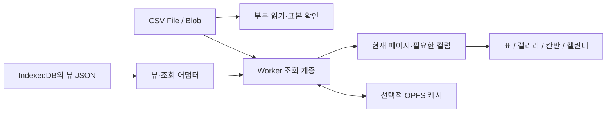

# CSV 다이나믹 뷰 통합 계획

작성일: 2026-11-11. 상태: 기술 검토와 구현 제안. 제품 구현과 브라우저 성능 실측은 포함하지 않는다.

파일별 변경·타입 계약·구현 순서·검증 기준은 별도 [구현 지시서](CSV_DYNAMIC_VIEW_IMPLEMENTATION.md)에 둔다.

CSV는 데이터 원본으로 두고, 파일별 JSON에 여러 뷰의 레이아웃·컬럼·조회 조건을 저장한다. 화면은 이 설정을 읽어 필요한 데이터만 요청한다. **뷰 설정 관리와 대용량 CSV 조회를 분리하는 구조**를 권한다.

## 1. 사용자가 만드는 화면

CSV에서만 `보기 추가`를 제공한다. 사용자가 이름, 레이아웃, 표시할 컬럼, 필터·정렬을 선택하면 JSON 설정을 만들고 해당 파일에 연결한다.

```text
[진행 현황] [마감 일정] [+ 보기 추가]  |  [보기] [원본]
```

- 사용자 뷰는 기존 `보기 / 원본`의 왼쪽에 저장 순서대로 표시한다. 재정렬과 이름 변경을 제공한다.
- 추가 과정은 `레이아웃 선택 → 컬럼 선택·타입 확인 → 필요한 연결 지정 → 미리보기 → 추가`다. 첫 버전은 표·갤러리, 다음 버전은 칸반·캘린더를 권한다.
- 갤러리는 제목·카드 내용, 칸반은 그룹 컬럼, 캘린더는 날짜 컬럼을 지정한다. 샘플에서 추론한 타입과 선택지는 사용자가 수정할 수 있다.
- `보기 관리`에서 수정·복제·삭제·순서 변경·뷰 가져오기·뷰 다운로드를 제공한다. 파일을 닫아도 설정은 남는다.
- 모바일에서는 같은 탭 목록을 가로 스크롤이나 선택 메뉴로 표시한다. 키보드 탐색과 선택된 탭 표시는 기존 동작을 확장한다.

## 2. 현재 구조와 라이브러리의 차이

| 확인한 부분 | 현재 동작 | 통합 시 필요한 변경 |
| --- | --- | --- |
| [파일 입력](../src/platform/browserFiles.ts), [앱 열기](../src/app/App.tsx) | Blob 참조를 보관하다 문서를 열 때 전체 `arrayBuffer()`를 읽음 | CSV의 파일 참조를 유지한 채 부분 조회 경로로 분기 |
| [CSV 파서](../src/domain/formats/csv.ts), [문서 타입](../src/domain/types.ts) | 전체 문자열과 `rows: string[][]`를 구성 | 대용량 문서는 전체 문자열·행 배열을 필수로 요구하지 않는 별도 세션 사용 |
| [CSV 표](../src/features/CsvEditor.tsx), [조회 Worker](../src/domain/csvView.worker.ts) | 화면은 가상화하지만 검색 Worker에도 전체 행과 검색용 문자열을 보관 | 조회 결과의 일부 페이지만 UI에 전달 |
| [탭](../src/app/DocumentHeader.tsx), [저장소](../src/platform/storage.ts) | 표시 모드는 `view / source`, 복구 저장소는 IndexedDB v3 | 사용자 뷰 선택 상태와 파일별 뷰 저장소 추가 |
| [입력 정책](../src/domain/inputPolicy.ts) | 데스크톱 50 MiB, 모바일 20 MiB 제한 | 새 CSV 조회 경로의 실측 후 해당 경로에만 별도 한도 적용 |

조사 대상은 [lotfibennour/shadcn-data-views](https://github.com/lotfibennour/shadcn-data-views)다. 확인한 소스 기준점은 [afe67ed](https://github.com/lotfibennour/shadcn-data-views/tree/afe67edde5755d28c75d5631db2b8dc9228c3aed)다.

- [데이터 클라이언트](https://github.com/lotfibennour/shadcn-data-views/blob/afe67edde5755d28c75d5631db2b8dc9228c3aed/src/lib/client.ts)의 조회 계약은 인자 없는 `getRecords(): Promise<IRecord[]>`다. 페이지·필터·정렬·취소 계약이 없다.
- [DataViews](https://github.com/lotfibennour/shadcn-data-views/blob/afe67edde5755d28c75d5631db2b8dc9228c3aed/src/components/DataViews.tsx)는 받은 레코드를 React 상태에 보관한다. [GridView](https://github.com/lotfibennour/shadcn-data-views/blob/afe67edde5755d28c75d5631db2b8dc9228c3aed/src/components/views/GridView.tsx)는 그 배열에 필터·정렬을 적용한다. 일부 페이지만 넣으면 전체 데이터의 정렬·필터로 오해할 수 있다.
- [패키지 설정](https://github.com/lotfibennour/shadcn-data-views/blob/afe67edde5755d28c75d5631db2b8dc9228c3aed/package.json)에 Next.js peer dependency가 있다. 현재 앱은 Vite·React 19와 자체 CSS·테마를 사용하므로 설치·스타일 호환성 확인이 필요하다.

**권장 통합 방식:** 필요한 뷰 컴포넌트를 소스 기준점에 고정해 재사용하고, 조회와 상태 관리를 앱에 맞게 확장한다. 기존 Glide 표는 유지한다. 재사용 화면의 헤더·테마 버튼·내부 뷰 탭은 공통 셸에 통합하고, 필터·정렬은 조회 계층으로 보낸다. MIT 고지와 수정 내역을 함께 관리한다. 패키지를 그대로 설치하는 방식은 소규모 기술 검증용으로 평가한다.

## 3. JSON에는 무엇을 저장하는가

파일 단위 설정 묶음에 파싱 규칙, 컬럼 연결·타입, 여러 뷰를 담는다. 컬럼 타입은 파일의 모든 뷰가 공유하고, 각 뷰는 표시 형식을 조정한다. 라이브러리의 `TableSchema`와 앱의 뷰 설정은 어댑터로 연결한다. 아래는 축약 예시다.

```json
{
  "schemaVersion": 1,
  "fileId": "file-uuid",
  "sourceHint": { "name": "tasks.csv" },
  "parser": { "encoding": "UTF-8", "delimiter": ",", "hasHeader": true },
  "columns": [
    { "id": "c0", "sourceIndex": 0, "sourceHeader": "업무", "type": "text" },
    { "id": "c1", "sourceIndex": 1, "sourceHeader": "상태", "type": "select" },
    { "id": "c2", "sourceIndex": 2, "sourceHeader": "마감일", "type": "date", "typeSource": "user", "parse": { "format": "YYYY-MM-DD" } }
  ],
  "views": [
    {
      "id": "view-uuid-1",
      "name": "진행 현황",
      "layout": "kanban",
      "visibleColumns": ["c0", "c1", "c2"],
      "filter": { "op": "eq", "columnId": "c1", "value": "진행 중" },
      "sort": [{ "columnId": "c2", "direction": "asc" }],
      "options": { "titleColumnId": "c0", "groupByColumnId": "c1" }
    },
    {
      "id": "view-uuid-2",
      "name": "마감 일정",
      "layout": "calendar",
      "visibleColumns": ["c0", "c2"],
      "options": { "titleColumnId": "c0", "dateColumnId": "c2" }
    }
  ]
}
```

- 실제 저장 계약에는 인용·이스케이프·개행·BOM과 날짜 해석 규칙, 뷰 순서·수정 시각도 포함한다.
- 컬럼 ID는 헤더명과 분리한다. 중복·빈 헤더를 허용하고 원래 위치를 함께 보관한다. 컬럼 구조가 바뀌면 다시 연결하게 한다.
- CSV 값은 기본적으로 문자열로 유지한다. `00123`, 큰 정수, 빈 문자열을 자동 변환하지 않는다. 숫자·날짜 타입은 표시와 쿼리를 위한 해석이며, 실패한 값의 처리 규칙도 저장한다.
- JSON에는 CSV 행 데이터와 실행 코드를 넣지 않는다. 필터는 구조화된 조건식으로 저장하고, 앱이 검증 후 SQL로 변환한다. 초기에는 사용자가 SQL을 직접 작성할 필요가 없다.
- 한 뷰 또는 해당 파일의 모든 뷰를 JSON으로 다운로드한다. 가져올 때는 열린 CSV에 컬럼을 매핑하고 ID 충돌을 처리한다. 파일 핸들·로컬 경로·인증 정보는 내보내지 않는다.

### 3.1. 컬럼 타이핑

컬럼 타이핑은 **CSV의 원문 문자열을 보존하면서 값의 의미를 지정하는 기능**이다. 원문, 조회에 사용하는 해석값, 화면 표시를 분리한다. 예를 들어 `00123`은 상품 코드라면 텍스트로 유지하고, `1,234.50`은 지정한 숫자 규칙으로 해석한 뒤 통화로 표시할 수 있다. 타입을 바꾸는 것만으로 CSV 내용을 다시 쓰지 않는다.

| 제안 타입 | 해석 규칙과 주의점 | 뷰에서의 사용 |
| --- | --- | --- |
| 텍스트 | 기본값. 앞자리 0·공백·긴 식별자를 보존 | 문자열 검색·정렬, 제목·설명 |
| 정수 / 소수 | 부호·소수점·천 단위 구분자·정밀도 규칙 지정. 큰 수를 JavaScript Number로 자동 반올림하지 않음 | 수치 비교·정렬·집계. 통화·퍼센트는 별도 표시 설정 |
| 불리언 | `true/false`, `예/아니오`, `1/0` 등의 대응표를 명시. 알 수 없는 값은 해석 실패 | 체크 표시·참/거짓 필터 |
| 날짜 / 날짜·시간 | 입력 형식을 지정. `01/02/03` 같은 모호한 값은 자동 확정하지 않음. 날짜는 날짜 자체로, 날짜·시간은 오프셋·시간대 규칙에 따라 처리 | 날짜 비교·기간 필터·캘린더 |
| 단일 선택 / 다중 선택 | 원문 값과 선택지·색을 연결. 다중 선택의 목록 구분 규칙은 CSV 구분자와 별도 지정 | 칸반 그룹·태그·포함 조건 |

URL·이메일·이미지 링크 등은 우선 텍스트의 표시 힌트로 다룬다. 통화 기호 제거, 퍼센트의 100분율 변환, 공백 제거, 목록 분해도 명시한 규칙으로만 수행한다. 선택지가 많은 컬럼의 전체 고유값 목록을 처음부터 읽지 않고 표본 후보와 사용자 입력을 사용한다.

**추천과 사용자 지정:** 처음 읽은 제한된 표본에서 후보 타입과 `표본 200개 중 198개 일치` 같은 근거를 보여 준다. 표본 판정은 전체 파일 검증을 뜻하지 않는다. 비어 있지 않은 표본이 부족하거나 타입이 섞여 있으면 텍스트를 기본으로 두고 후보를 제시한다. 헤더명은 보조 근거로만 사용한다. 사용자가 확정한 타입은 뒤에서 다른 값이 나와도 자동 변경하지 않는다.

`컬럼 타입` 설정에서 원문 예시·해석 결과·실패 예시를 함께 보고 타입과 입력 규칙을 수정한다. 공통 타입 변경은 영향을 받는 뷰를 표시한 뒤 적용하고, 뷰별 날짜·숫자 표시 형식은 별도로 저장한다. 타입의 출처(`inferred / user`)와 해석·표시 규칙을 JSON에 보관한다. 다음은 소수 컬럼 설정의 축약 예시다.

```json
{
  "id": "c3",
  "sourceIndex": 3,
  "sourceHeader": "금액",
  "type": "decimal",
  "typeSource": "user",
  "parse": { "decimalSeparator": ".", "groupSeparator": ",", "precision": 18, "scale": 2, "trim": false },
  "display": { "style": "currency", "currency": "KRW", "fractionDigits": 2 }
}
```

**해석 실패:** 셀 상태를 정상값·빈 문자열·컬럼이 누락된 값·해석 실패로 구분한다. 해석 실패를 `0`, `false`, 정상적인 빈 값으로 바꾸지 않는다. 원문과 실패 이유를 보존하고 `해석 실패` 조건으로 찾을 수 있게 한다. `NULL`, `N/A` 같은 문자열을 결측값으로 취급하려면 별도 규칙을 지정한다.

숫자·날짜 필터와 집계에는 정상 해석값을 사용하고, 제외된 빈 값·누락·실패 건수를 구분한다. 건수는 표본·조회 범위·전체 검증 중 어느 범위인지 표시한다. 정렬 기본 순서는 정상값 다음 빈 값·누락·실패이며, 같은 값은 안정적인 행 ID로 순서를 정한다. 집계를 위해 전체를 읽는 비용은 타입 추론과 분리한다.

작은 파일의 메모리 어댑터와 큰 파일의 SQL 어댑터에 같은 타입·빈 값·실패 규칙을 적용한다. 공통 타입 변경 시 `schemaRevision`을 갱신하고 관련 쿼리·cursor·해석값 캐시를 무효화한다. JSON 형식의 버전인 `schemaVersion`, 원본 변경의 기준인 `sourceRevision`과 구분한다. 재열기와 JSON 가져오기에서도 사용자 지정 타입과 해석 규칙을 복원한다.

[라이브러리 필드 타입](https://github.com/lotfibennour/shadcn-data-views/blob/afe67edde5755d28c75d5631db2b8dc9228c3aed/src/lib/schema.ts)은 `text / number / select / multiSelect / date / checkbox`다. 앱의 정수·소수, 날짜·시간 등 세부 의미는 자체 스키마에 유지하고 어댑터에서 연결한다. 큰 정수·정밀 소수는 정확한 표시가 가능한 렌더러를 사용하며, 화면 컴포넌트의 Number 변환으로 원문이나 해석값의 정밀도가 소실되지 않게 한다.

## 4. 파일 식별과 브라우저 보관

현재 문서의 `document.id`는 열기 시 생성되는 세션 식별자다. 여러 번 연 같은 파일의 뷰를 찾을 수 있도록 영속적인 `fileId`를 별도로 둔다.

| 항목 | 역할 |
| --- | --- |
| `documentId` | 현재 열린 편집 세션 |
| `fileId` | 파일과 여러 뷰 설정을 연결하는 영속 ID |
| `sourceRevision` | 파일 내용·현재 작업본이 변경되었는지 구별하는 기준 |
| `viewId` | 파일 안의 개별 뷰 |

파일 핸들이 있으면 `isSameEntry()`로 같은 파일을 확인하고, 폴더 파일은 보관한 루트와 상대 경로도 사용한다. 핸들이 없는 입력은 이름·크기·수정 시각·헤더와 일부 바이트의 지문으로 후보를 찾는다. **부분 지문은 완전한 내용 동일성을 증명하지 않는다.** 후보가 모호하면 기존 파일에 연결할지 선택하게 하며, 동일성 확인을 위해 처음부터 전체 파일 해시를 계산하지 않는다.

- IndexedDB에 파일 등록 정보와 `(fileId, viewId)`별 설정을 저장한다. 인덱스·Parquet 등 큰 재생성 가능 캐시는 OPFS에 분리한다.
- 기존 v3 DB에 저장소를 추가한다면 DB 버전을 올리고 기존 문서·복구 데이터를 보존한다. 뷰 JSON의 `schemaVersion`은 DB 버전과 별도로 관리한다.
- 문서 닫기·폴더 전환·문서 복구 정리로 뷰 설정을 삭제하지 않는다. `보기 관리`와 설정에서 파일별 뷰 삭제, 전체 뷰 백업, 캐시 정리를 제공한다. 캐시 정리는 설정을 보존한다.
- 같은 파일을 다시 읽었는데 내용이 바뀌면 설정은 유지하고 조회 캐시는 폐기한다. 컬럼 연결이 맞지 않는 뷰는 재매핑 전 실행하지 않는다.
- 브라우저를 다시 열어도 설정은 복원한다. 원본 접근 권한이 사라지면 파일을 다시 선택한다. 캐시가 없는 원본을 자동 복구할 수 있다고 약속하지 않는다.

OPFS와 IndexedDB는 브라우저 저장 용량과 사이트 데이터 삭제의 영향을 받는다. 저장 공간을 조회하고, 설정과 캐시의 사용량을 구분해 보여 준다. 브라우저 사이의 이동은 JSON 다운로드·가져오기로 처리한다. [OPFS](https://developer.mozilla.org/en-US/docs/Web/API/File_System_API/Origin_private_file_system), [저장 용량 정책](https://developer.mozilla.org/en-US/docs/Web/API/Storage_API/Storage_quotas_and_eviction_criteria)을 기준으로 구현한다.

## 5. 대용량 조회 구조



조회 엔진은 **DuckDB-Wasm을 우선 검증**한다. 작은 CSV의 현재 작업본은 메모리 어댑터로 연결하고, 큰 파일은 File/Blob을 등록해 직접 조회한다. 화면은 두 경로에 같은 요청을 보낸다. 파일 전체를 JSON 배열이나 DB 테이블로 먼저 변환하는 과정은 필수로 두지 않는다.

처음에는 Worker에서 헤더와 소량의 레코드만 읽는다. 기존 Papa Parse의 [파일·청크 파싱](https://www.papaparse.com/docs)을 활용하되, 줄 단위 문자열 분할은 사용하지 않는다. 인용 필드 안의 개행과 청크 경계의 한글·따옴표를 처리해야 한다. 파싱 설정과 문자열 컬럼을 확정한 뒤 DuckDB의 CSV 자동 탐지에 맡기는 범위를 줄인다.

DuckDB-Wasm은 [파일 등록](https://duckdb.org/docs/2.0/clients/wasm/data_ingestion)과 [결과 배치 조회 `send()`](https://duckdb.org/docs/2.0/clients/wasm/query)를 제공한다. CSV에는 [명시적 컬럼·파싱 옵션](https://duckdb.org/docs/2.0/data/csv/overview)을 사용한다. 일부 결과만 UI 객체로 만들고, 전체 결과의 `toArray()` 변환은 피한다.

조회 요청과 응답은 다음 의미를 갖는다. 구체적인 타입명은 구현 시 확정한다.

```text
요청: fileId, sourceRevision, schemaRevision, requestId,
      표시 컬럼, 필터, 정렬, 날짜 범위, 그룹 조건, cursor, limit
응답: rows, nextCursor, hasMore,
      total(미확인 / 추정 / 정확), diagnostics
동작: query / cancel / dispose
```

- 첫 기본값은 페이지 200행, 다음 페이지 1개 선읽기, 제한된 LRU 캐시를 제안한다. 페이지 수와 별도로 바이트 예산도 둔다. 매우 큰 셀 하나가 예산을 넘는 경우를 처리한다.
- 필터 변경·탭 전환·문서 닫기는 이전 쿼리를 취소한다. `requestId`·`sourceRevision`·`schemaRevision`이 지난 응답은 버린다. 취소 API와 중단 지연은 기술 검증에서 확인한다.
- cursor는 Worker가 보관하는 결과 스트림의 위치를 가리킨다. 큰 `OFFSET`을 반복하는 방식으로 구현하지 않는다. 만료된 cursor와 임의의 먼 페이지 이동에는 재조회 비용이 있음을 계약에 둔다.
- 필터·정렬은 전체 데이터 기준으로 실행한다. 값은 매개변수로 바인딩하고 컬럼은 등록된 ID만 사용한다. 조회 컬럼에는 화면에 숨긴 필터·정렬·그룹용 컬럼도 포함한다.
- 행 ID는 원본 revision 안에서 안정적인 레코드 위치 또는 검증된 키로 만든다. 정렬 후 화면 행 번호를 ID로 쓰지 않는다. 생성 방법과 페이지 간 중복·누락은 기술 검증 항목이다.

## 6. 부분 읽기로 해결되는 범위

**전체 파일을 메모리에 올리지 않는 것과 전체 파일을 읽지 않는 것은 다르다.** CSV에는 일반적으로 컬럼·행 위치 인덱스가 없다. 특정 컬럼만 선택해도 레코드 경계를 찾기 위해 다른 바이트를 지나가야 한다. 다음 비용을 사용자 동작과 조회 계약에 반영한다.

| 동작 | 필요한 작업 |
| --- | --- |
| 처음 열기·원본 순서의 다음 행 | 필요한 앞부분부터 청크로 읽고 표시 가능. 정확한 전체 행 수는 기다리지 않음 |
| 필터와 상한 개수 | 조건을 만족하는 행을 찾으며 읽음. 결과가 드물거나 없으면 파일 끝까지 읽을 수 있음 |
| 전체 정렬·정확한 합계/개수 | 대체로 전체 스캔이 필요. 정렬은 추가 작업 메모리도 필요 |
| 칸반 | 그룹별 cursor와 제한을 사용. 첫 페이지를 그룹으로 나눠 전체 보드처럼 표시하지 않음 |
| 캘린더 | 표시 기간만 결과로 반환. 날짜 인덱스가 없으면 기간 필터도 전체 스캔이 필요할 수 있음 |
| 같은 파일의 반복 분석 | 선택적으로 한 번 전체 분석해 Parquet·조회 캐시 구성. 이후 필요한 컬럼·범위 읽기 개선 |

정확한 전체 개수는 페이지마다 계산하지 않는다. 표본·부분 결과를 전체 결과처럼 표시하지 않고, 완료 전에는 전체 개수를 미확인으로 둔다. 칸반의 그룹 수가 많으면 사용자 지정 그룹과 추가 그룹 조회를 사용한다.

DuckDB-Wasm에도 [브라우저·Wasm 메모리 한계](https://duckdb.org/docs/2.0/clients/wasm/overview)가 있다. 결과를 스트리밍해도 전체 정렬의 작업 메모리가 페이지 크기로 제한되지는 않는다. OPFS 캐시가 모든 메모리 부족을 해결한다고 가정하지 않는다. 큰 정렬·분석의 상한은 별도로 실측하고, 초과 시 필터 축소나 캐시 구성 등 실행 가능한 선택을 안내한다.

## 7. 기존 편집·원본·파일 전달과의 연결

- 작은 CSV의 `보기 / 원본` 편집은 현재 세션을 유지한다. 사용자 뷰는 초기에는 조회용으로 제공한다. 뷰 설정 변경은 CSV의 `수정됨`·Undo 이력과 분리하고, 데이터 편집은 기존 보기에 연결한다.
- 작은 파일의 미저장 편집도 사용자 뷰에 반영한다. 디스크 원본을 따로 조회해 이전 데이터를 보여 주지 않는다. 파싱 오류 상태는 기존 세션 정책을 따라 마지막 유효 결과와 현재 원문을 구별한다.
- 대용량 파일의 첫 단계는 읽기 전용을 제안한다. 기본 표도 부분 조회를 사용하고, `원본`은 범위별 읽기와 원본 파일 다운로드를 제공한다. 전체 원문 편집기로 자동 전환하지 않는다. 이는 현재의 전체 원문 편집 요구에 대한 **대용량 경로의 추가 제안**이며, 기존 지원 범위의 편집을 제한하는 결정이 아니다.
- 사용자 뷰에서 셀 수정·칸반 드래그·폼 입력을 제공하려면 안정적인 행 ID, 변경 패치, 공통 이력과 스트리밍 CSV 저장을 먼저 설계한다. Form 뷰와 대용량 쓰기는 후속 범위로 둔다.
- 파일 열기 과정의 별도 진행 다이얼로그는 추가하지 않는다. 조회 대기·실패·추가 로드는 해당 뷰 영역에서 처리한다. 큰 셀·파싱 오류를 조용히 누락하지 않는다.
- 1차 대용량 대상은 PWA의 직접 파일 선택·드롭·폴더 열기다. 현재 [확장 수신](../src/platform/pwa/extensionRelay.ts)은 청크를 받더라도 전체 크기의 버퍼를 할당한다. 대용량 확장 전달은 송신·티켓 저장·수신을 함께 바꾸는 별도 단계다.
- HTTP(S)는 Range·CORS·파일 변경 검증 지원 여부를 확인해야 한다. 지원이 없으면 전체 다운로드가 필요할 수 있다. 원격 파일을 작은 네트워크 요청만으로 열 수 있다고 일반화하지 않는다.
- 기존 한국어 인코딩을 유지한다. EUC-KR 등 직접 조회에서 지원되지 않는 인코딩은 Worker의 스트리밍 디코딩·UTF-8 임시 캐시 경로를 검증한다. 이 경우 준비를 위한 전체 스캔이 필요할 수 있다.
- Wasm·Worker·필요한 확장은 같은 출처의 버전 고정 자산으로 제공한다. [단일 스레드와 OPFS 배포 조건](https://duckdb.org/docs/2.0/clients/wasm/instantiation)을 확인하고, 기본 동작을 멀티스레드용 격리 헤더에 의존시키지 않는다. 오프라인 자산 준비는 기존 런타임 자산 정책에 연결한다.

## 8. 구현 순서와 완료 기준

| 단계 | 작업 | 완료 기준 |
| --- | --- | --- |
| 1. 기술 검증 | Vite·React 19에서 재사용 뷰와 DuckDB 파일 조회 검증 | 전체 바이트 복사 없이 큰 CSV 첫 화면 표시, 쿼리 취소·메모리·스타일 영향 확인 |
| 2. 설정과 파일 연결 | JSON 계약·컬럼 타입·파일 ID·IndexedDB 이행·다운로드/가져오기 | 재열기·같은 이름의 다른 파일·컬럼 변경·타입 설정·기존 세션 복구 검증 |
| 3. 첫 사용자 뷰 | 탭·추가/관리 화면·컬럼 타입 설정·표/갤러리·작은 파일 어댑터 | 직접 만든 뷰를 왼쪽 탭에서 열고 백업·복원, 타입 기반 필터·정렬과 미저장 작업본 반영 |
| 4. 대용량 경로 | 파일 기반 세션·Worker·배치 결과·기본 표/원본 범위 읽기 | 전체 `text`와 `rows` 없이 열람, 파일 한도와 오류·캐시 예산 확정 |
| 5. 레이아웃 확장 | 칸반·캘린더·반복 분석 캐시 | 그룹/기간 전체 조회 정확성, 캐시 변경 감지·정리 검증 |
| 후속 | 대용량 확장/원격 전달·데이터 수정·Form | 입력부터 저장까지 전체 버퍼 의존 제거와 편집 계약 검증 |

기술 검증에서 조회 비용이나 재사용 컴포넌트의 수정 범위가 예상보다 크면, 결과를 근거로 뷰 재사용 범위를 조정한다. 대용량 조회 기반은 화면 라이브러리와 독립적으로 유지한다.

구현 경계는 [컴포넌트 작성 규칙](COMPONENTS.md)을 따른다. 화면은 설정·결과를 받고 콜백을 보내며, CSV 해석·쿼리 변환·파일 접근·브라우저 저장을 직접 수행하지 않는다. [문서 타입](../src/domain/types.ts)의 현재 문자열·행 배열 계약에 빈 값으로 대용량 파일을 끼워 넣지 말고 별도 판별 가능한 세션을 설계한다. 사용자 뷰 선택도 기존 `view / source` 값에 임의 문자열을 넣지 않고 별도 선택 상태로 확장한다.

## 9. 검증과 출시 판단

- 정확성: 인용된 개행, 이스케이프 따옴표, 한글 청크 경계, BOM·개행·인코딩, 중복·빈 헤더, 헤더 없음, 행별 열 수 차이, 매우 큰 셀을 확인한다. 기존 Papa 파서와 새 조회 경로의 차이를 명시적으로 처리한다. 빈 문자열을 SQL NULL로 자동 바꾸지 않는다.
- 타이핑: 앞자리 0·큰 정수·정밀 소수·천 단위 구분자·통화/퍼센트·불리언 대응표·모호한 날짜·시간대·다중 선택을 확인한다. 빈 문자열·누락·실패·혼합 타입과 표본 밖의 예외를 구별하고, 두 조회 어댑터의 결과 일치·타입 변경 후 캐시 무효화·JSON 왕복을 검증한다.
- 뷰: 모든 레이아웃의 컬럼 연결, 전체 기준 필터·정렬, 안정적인 페이지 이동, 그룹별 추가 조회, 날짜 해석, 탭 키보드·모바일·테마를 확인한다.
- 보관: DB v3 이행, 재시작, 파일 재선택, 파일 변경, 잘못된 JSON·알 수 없는 버전, 다운로드 후 가져오기, 저장 용량 부족과 캐시 삭제를 확인한다.
- 성능: 데스크톱 10/50/250 MiB·1 GiB, 모바일 5/20 MiB와 추가 실험 파일에서 첫 표시 시간·읽은 바이트·UI 스레드 지연·JS/Wasm 최고 메모리를 기록한다. 기기·브라우저·행 너비·인코딩을 함께 남긴다. 이 크기는 시험 구간이며 지원 한도나 달성한 성능이 아니다.
- 부분 읽기: 첫 표본은 예를 들어 1 MiB부터 최대 8 MiB까지 제한해 확장하고, 긴 미완성 레코드는 별도로 처리한다. 첫 표시 전에 파일 끝까지 읽지 않는지 계측한다. 전체 정렬·집계는 별도 시나리오로 측정한다.
- 배포: 루트와 Pages 하위 경로, 오프라인 재열기, Worker/Wasm 자산, 기존 편집·저장·복구 회귀를 확인한다. 제품 코드 변경 시 필요한 타입·린트·테스트·빌드 검사를 수행한다.

우선 구현 묶음은 **파일별 뷰 설정 관리 + 표/갤러리 + 대용량 직접 파일 조회**를 권한다. 칸반·캘린더는 같은 조회 계약 위에 추가한다. 기능 배포 커밋에서는 당시 최신 버전에서 MINOR를 올리고, [패키지](../package.json)·[잠금 파일](../package-lock.json)·[공개 버전](../public/version.json)을 맞춘다.
